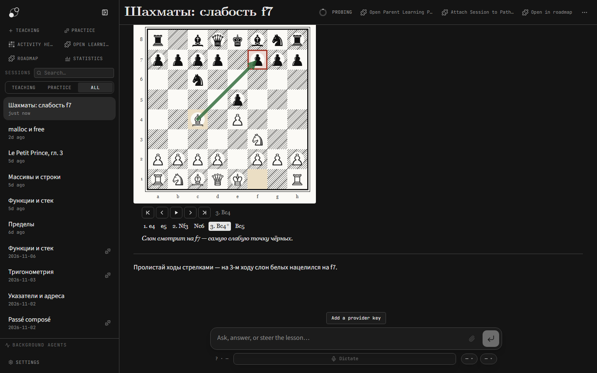
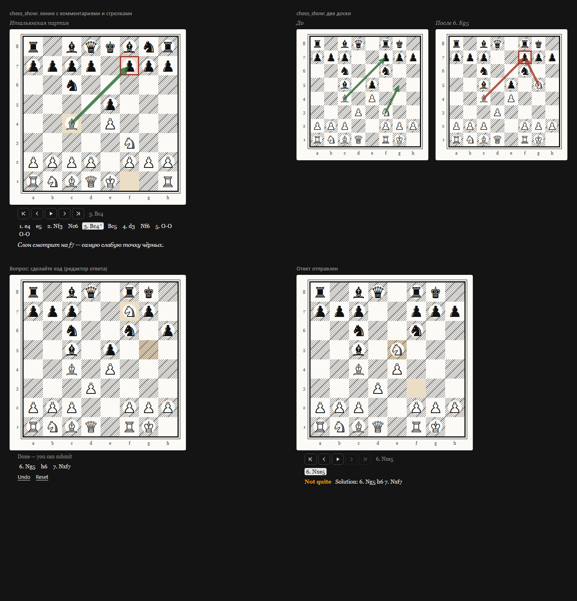

# Chess — LearnHarness plugin

Chess for lessons without asking the AI to draw. The teacher only names a
position (FEN) and moves (`Nf3`, `O-O`, `g1f3`); the plugin draws the board in a
calm "chess book" style, animates the moves and checks every move by the rules.



## What the AI can do with it

The plugin teaches the teacher, practice and probing agents when to use it, so
they reach for a board on their own whenever a position matters.

- **Show a position** with arrows (green idea, red threat, blue alternative,
  yellow attention) and highlighted squares.
- **Show a line** — an opening, a combination, a game fragment. You step through
  it with ⏮ ◀ ▶ ⏭, click any move, or press ▶ to watch it play with animation.
  Moves can carry their own comment and arrows.
- **Show several boards at once** — before/after, two candidate moves, one
  pattern in different positions.
- **Ask you to make the move.** In lessons this is a regular LearnHarness
  question (the question text, thinking field and answer card are the app's
  own); the answer is the board, where you move the pieces by click or drag. The
  board plays the opponent's replies of the solution, accepts a different mate of
  the same length, and sends your moves and a verdict back to the teacher.
- **Practice tasks** with the same board in practice sessions.

Every position and move is validated. A wrong call shows nothing and tells the
AI exactly what to fix (for example `"e5" is not legal here (White to move).
Legal moves: …`), so it corrects itself.



## Install

1. Download `chess-<version>.zip` from the latest release.
2. In LearnHarness open **Settings → Community plugins** and copy the plugins
   directory path.
3. Unzip there so that `<plugins-directory>/chess/dist/manifest.json` exists.
4. Press **Refresh**, enable **Chess**, and restart LearnHarness.

From source:

```sh
git clone https://github.com/Doshhhh/chess-learnharness.git
cd chess-learnharness
npm ci
npm run install:local -- "<plugins-directory>"
```

## For the curious: the tools

| Tool | Agents | Purpose |
| --- | --- | --- |
| `chess_show` | teacher, practice, prober | One to six boards: `fen`, `moves` (with `comment`, `arrows`, `highlights`), `arrows`, `highlights`, `orientation`, `startAt`, `caption` |
| `chess_move_question` / `chess_move_probe` | teacher / prober | A question answered by playing on the board; `payload.fen`, optional `payload.solution` |
| `chess_problem` | practice | A practice task on the board |

## Development

```sh
npm ci
npm test
npm run typecheck   # needs the LearnHarness plugin SDK types in .sdk/
npm run build
```

## License

[MIT](./LICENSE). Bundled third-party code and the glyph font are listed in
[THIRD-PARTY.md](./THIRD-PARTY.md).
